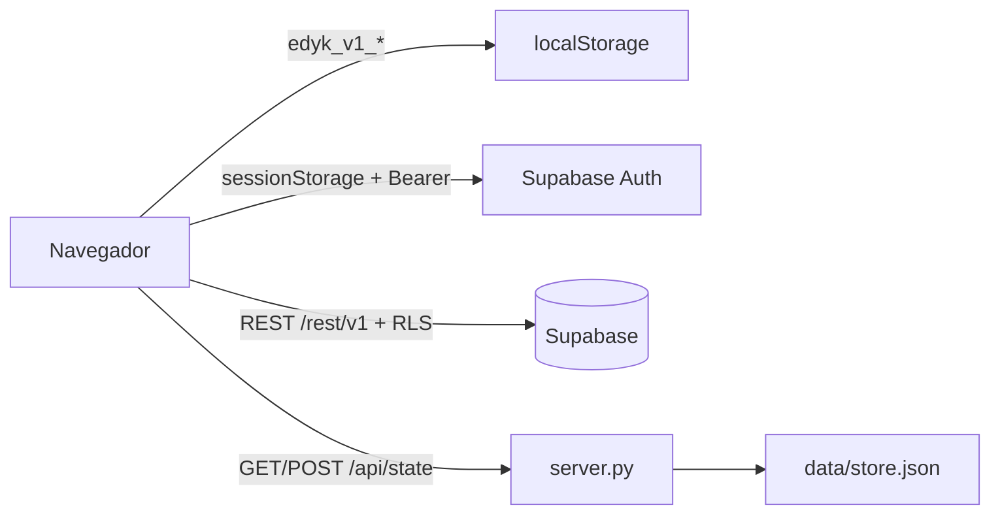

<div align="center">


# EDY-K Barbershop

**Agendamento online, loja de produtos e painel administrativo em HTML, CSS e JavaScript puro — sem build, sem npm e sem etapa de compilação.**

<p>
  
  
  
  
  
  
</p>

</div>


## Sumário

- [Visão geral](#visão-geral)
- [Stack](#stack)
- [Funcionalidades](#funcionalidades)
- [Guia rápido](#guia-rápido)
- [Contas de demonstração](#contas-de-demonstração)
- [Arquitetura de dados](#arquitetura-de-dados)
- [Integração com Supabase](#integração-com-supabase)
- [Testes](#testes)
- [API local (Python)](#api-local-python)
- [Deploy](#deploy)
- [Estrutura do projeto](#estrutura-do-projeto)
- [Segurança](#segurança)
- [Solução de problemas](#solução-de-problemas)
- [Changelog](#changelog)
- [Roadmap](#roadmap)
- [Contribuindo](#contribuindo)
- [Contato](#contato)
- [Licença](#licença)

## Visão geral

Este repositório contém a versão definitiva da EDY-K Barbershop, convertida de **React + TypeScript + Vite** para **HTML, CSS, JavaScript clássico e Python**.

O resultado é uma SPA leve que pode ser executada de três formas:

1. Abrindo `index.html` diretamente (`file://`);
2. Rodando `python server.py` em localhost, com API opcional de persistência;
3. Fazendo deploy estático no Vercel.

Não há `package.json`, `node_modules`, transpilação ou build. Usuários e produtos podem ser sincronizados com **Supabase** via REST; os demais dados seguem no `localStorage` do navegador.

## Stack

| Camada | Tecnologia | Uso |
| --- | --- | --- |
| Interface | HTML5 + CSS3 | Layout responsivo, tema escuro/dourado, componentes e animações |
| Lógica | JavaScript clássico (`app.js`) | Rotas por hash, estado, agendamentos, loja, fidelidade e admin |
| Configuração | `config.js` | URL e chave pública do Supabase |
| Banco remoto | Supabase REST / PostgREST | Tabelas `users` e `products` |
| Persistência local | `localStorage` (`edyk_v1_*`) | Agendamentos, pedidos, pontos, carrinho e configurações |
| Servidor local | Python 3 (`http.server`) | Arquivos estáticos + API `GET/POST /api/state` |
| Deploy | Vercel (`vercel.json`) | Hospedagem estática sem build |
| PWA | `manifest.webmanifest` + ícones | Instalação e ícones adaptativos |

## Funcionalidades

### Área do cliente

- Página inicial com serviços, elenco, avaliações, loja e disponibilidade.
- Agendamento em 4 etapas: serviço → profissional → data/hora → dados e pagamento.
- Remarcação, cancelamento, histórico e avaliação de atendimentos.
- Loja com filtros por categoria, carrinho e checkout.
- Pagamento via Pix ou cartão, com retirada/entrega, cupons e frete.
- Baixa automática de estoque após compra.
- Meus Pedidos e Meus Horários.
- Programa de fidelidade: pontos, resgate de recompensas e extrato.
- Login e cadastro via Supabase Auth quando configurado; acessos rápidos apenas no modo demo offline.

### Painel administrativo

- Dashboard com indicadores.
- Gestão da agenda e status de agendamentos.
- CRUD de usuários, serviços, produtos, barbeiros e recompensas.
- Moderação de avaliações e configuração de fidelidade.
- CMS de configurações gerais da loja.
- Aba **Supabase** com status, configuração, publicação de dados iniciais e teste de insert/exclusão.

### Infraestrutura

- Tema EDY-K escuro/dourado com responsividade para desktop, tablet e mobile.
- PWA com manifest e ícones 192/512/maskable.
- Compatível com `file://`, `localhost` e domínios estáticos.
- Sem dependências de terceiros no front-end.

## Guia rápido

### Pré-requisitos

- Navegador moderno com suporte a `fetch` e `localStorage`.
- **Opcional:** Python 3.8+ para o servidor local.
- **Opcional:** Node.js 18+ para o script de teste do Supabase.

### Opção 1 — abrir direto no navegador

Abra `index.html` com duplo clique. Nenhum servidor é necessário.

### Opção 2 — servidor Python (recomendado em desenvolvimento)

```bash
python server.py          # http://localhost:8000
python server.py 3000     # porta personalizada
```

Ativa a API local de persistência em `data/store.json`. Sem ela, o app usa apenas `localStorage`.

### Opção 3 — Vercel

Importe o repositório no Vercel e use:

| Configuração | Valor |
| --- | --- |
| Framework Preset | `Other` |
| Build Command | vazio |
| Install Command | vazio |
| Output Directory | `.` |

Esses valores já estão em `vercel.json`. Não é preciso `npm install` nem variáveis de ambiente. A API Python não é implantada e o app detecta isso automaticamente.

## Contas de demonstração

| Perfil | E-mail | Senha sugerida |
| --- | --- | --- |
| Administrador | `admin@edyk.com` | `admin123` |
| Cliente | `cliente@edyk.com` | `123456` |

- **Sem Supabase configurado:** são contas locais, com botões de acesso rápido na tela de login.
- **Com Supabase configurado:** crie esses e-mails em **Authentication → Users**, use as senhas escolhidas e promova o admin conforme o passo 2 da integração. Os botões de acesso rápido desaparecem; o login passa a ser feito pelo Supabase Auth.

## Arquitetura de dados



| Dado | Onde fica |
| --- | --- |
| Contas e senhas | Supabase Auth (`auth.users`), quando configurado; `localStorage` apenas no modo demo offline |
| Perfis e produtos | Supabase, protegidos por RLS; `localStorage` como fallback |
| Agendamentos, pedidos, pontos, recompensas, carrinho e configurações | `localStorage` |
| Estado compartilhado em localhost | `data/store.json` via API Python |
| Sessão (`edyk_auth_session`) e perfil atual | `sessionStorage` do navegador; nunca enviados para a API compartilhada |

## Integração com Supabase

A integração usa **Supabase Auth + REST/PostgREST direto no navegador**, sem SDK e sem npm. A chave publicável/anon é própria para o cliente; a `service_role` nunca deve aparecer no front-end.

### 1. Prepare o banco

1. Crie um projeto em [supabase.com](https://supabase.com).
2. Aba **SQL Editor → New query**.
3. Execute todo o conteúdo de [`supabase.sql`](supabase.sql).

> O script **recria `public.users`**. As tabelas atuais estão vazias, mas exporte dados se houver informações importantes.

O SQL cria perfis ligados a `auth.users`, remove a coluna de senha, habilita RLS, aplica `GRANT`s mínimos e cria o helper `public.is_admin()`, que lê o papel do **JWT assinado** — não do `localStorage`.

### 2. Crie os usuários no Supabase Auth

Em **Authentication → Users → Add user**, crie pelo menos:

- `admin@edyk.com` com a senha desejada;
- `cliente@edyk.com` com a senha desejada.

Depois, ainda no SQL Editor, promova o administrador (o SQL de exemplo também está no final de `supabase.sql`):

```sql
update auth.users
set raw_user_meta_data = coalesce(raw_user_meta_data, '{}'::jsonb) || '{"role":"admin"}'::jsonb
where email = 'admin@edyk.com';
```

Faça **logout/login** no app para o JWT receber a nova claim. O perfil em `public.users` é criado automaticamente no primeiro login.

### 3. Configure as credenciais

Edite `config.js`:

```js
window.EDYK_SUPABASE = {
  url: 'https://SEU-PROJETO.supabase.co',
  anonKey: 'SUA_PUBLISHABLE_OU_ANON_KEY'
};
```

Também é possível configurar pelo app, sem redeploy:

**PAINEL ADMIN → Supabase → preencher URL/chave → SALVAR E CONECTAR**

Prioridade de configuração:

1. `localStorage.edyk_supabase_config` (painel admin);
2. `window.EDYK_SUPABASE` (`config.js`).

Salvar o painel com campos vazios limpa a configuração anterior e volta a usar o arquivo.

### 4. O que o RLS permite

| Operação | Visitante (anon) | Cliente autenticado | Admin autenticado |
| --- | --- | --- | --- |
| Ler produtos ativos | ✅ | ✅ | ✅ |
| Ler produtos inativos | ❌ | ❌ | ✅ |
| Criar/editar/excluir produtos | ❌ | ❌ | ✅ |
| Ler próprio perfil | ❌ | ✅ | ✅ |
| Ler todos os perfis | ❌ | ❌ | ✅ |
| Criar próprio perfil | ❌ | ✅ (sem poder virar admin) | ✅ |

### 5. Sincronização automática

Com a conexão ativa, o app:

- autentica login/cadastro pelo Supabase Auth;
- cria o perfil do usuário no primeiro login;
- carrega produtos e, quando há sessão, os perfis autorizados, mesclando pelo `id`;
- grava, edita e exclui produtos no CRUD admin somente com sessão admin;
- atualiza o estoque remoto após cada pedido;
- mantém agendamentos, pedidos, pontos e carrinho no `localStorage`.

Contas de acesso são gerenciadas no Supabase Auth. O painel admin não cria nem apaga usuários do Auth; alterações locais de perfil são apenas cosméticas e não alteram permissões.

## Testes

### Pelo painel (recomendado)

Entre como **admin do Supabase Auth** e vá em **PAINEL ADMIN → Supabase → TESTAR INSERT/EXCLUSÃO**.

O teste valida:

1. permissão de administrador via RLS;
2. inserção de produto temporário;
3. leitura do próprio perfil;
4. leitura pública do produto ativo;
5. exclusão do produto temporário.

Resultado esperado: **PASSOU (5/5)**.

### Pelo terminal

```bash
# macOS/Linux
SUPABASE_ADMIN_EMAIL=admin@edyk.com \
SUPABASE_ADMIN_PASSWORD=SUA_SENHA \
node test-supabase.mjs
```

```powershell
# Windows PowerShell
$env:SUPABASE_ADMIN_EMAIL = "admin@edyk.com"
$env:SUPABASE_ADMIN_PASSWORD = "SUA_SENHA"
node test-supabase.mjs
```

`SUPABASE_URL` e `SUPABASE_ANON_KEY` são opcionais: se não existirem, o script lê `config.js`.

O teste também verifica que um visitante anônimo **não consegue** gravar produtos nem ler usuários. Resultado esperado:

```text
OK   Login com Supabase Auth
OK   Role admin aplicada no RLS
OK   Admin insere produto
OK   Admin consulta produto
OK   Usuário lê apenas o próprio perfil
OK   Anônimo lê produto ativo
OK   Anônimo NÃO grava produto
OK   Anônimo NÃO lê usuários
OK   Excluir produto de teste

Resultado: SUCESSO (9/9 etapas)
```

## API local (Python)

Disponível somente em `localhost` quando `server.py` está rodando.

| Método | Rota | Descrição |
| --- | --- | --- |
| `GET` | `/health` ou `/api/health` | Health check; responde `{"status":"ok"}` |
| `GET` | `/api/state` | Retorna o estado salvo em `data/store.json` |
| `POST` | `/api/state` | Salva o estado recebido em `data/store.json` |

A sessão `currentUser` é deliberadamente excluída do estado compartilhado.

## Deploy

O deploy é inteiramente estático. O `vercel.json` já define `framework: null`, `buildCommand: null`, `installCommand: null` e `outputDirectory: "."`.

No Vercel:

- `server.py` não é executado;
- a API local `/api/state` não existe e é ignorada pelo app;
- `localStorage` continua funcionando normalmente;
- com Supabase configurado, usuários e produtos são compartilhados entre dispositivos e origens.

## Estrutura do projeto

```text
.
├── index.html              # SPA, emblema SVG e carregamento dos scripts
├── styles.css              # Tema EDY-K, layout e responsividade
├── app.js                  # Estado, rotas, regras de negócio, Auth e integração Supabase
├── config.js               # URL e chave pública do Supabase
├── server.py               # Servidor estático + API JSON local
├── supabase.sql            # Perfis, GRANTs mínimos, RLS e helper is_admin()
├── test-supabase.mjs       # Teste de Auth, RLS e insert/consulta/delete via REST
├── vercel.json             # Configuração de deploy estático
├── manifest.webmanifest    # PWA
├── metadata.json           # Metadados do aplicativo
├── assets/
│   ├── icon.svg
│   ├── icons/              # Ícones PWA 192/512/maskable
│   └── images/             # Hero, elenco, barbeiros e produtos
├── public/                 # Legado estático mantido por compatibilidade
└── data/                   # store.json gerado pelo servidor Python (ignorado no Git)
```

## Segurança

- A chave `anon`/`publishable` pode ficar no front-end **somente com RLS configurado**.
- **Nunca** coloque a `service_role` em `config.js`, no painel ou em qualquer arquivo cliente.
- Login/cadastro usam Supabase Auth; a tabela `public.users` não armazena senha.
- RLS usa `auth.uid()` e o helper `public.is_admin()`, baseado em claim do JWT. Mudar o `role` no `localStorage` ou na tabela não concede acesso administrativo.
- Visitantes só leem produtos ativos; escrita remota é exclusiva de admins autenticados.
- O token de sessão fica em `sessionStorage` (`edyk_auth_session`) e **não** é enviado para a API Python compartilhada; ele expira com a aba do navegador.
- Em dispositivos compartilhados, use **Sair do painel**/logout ao terminar.
- Não exponha `data/store.json` em um servidor público: ele contém o estado local da aplicação.
- Para produção, mantenha confirmação de e-mail ativada no Supabase Auth e considere mover agendamentos/pedidos para tabelas com RLS próprio.

## Solução de problemas

| Sintoma | Causa provável | Solução |
| --- | --- | --- |
| `401` com `No API key found` | Chave não preenchida | Preencha `anonKey` em `config.js` ou no painel |
| `PGRST205` | Tabelas não criadas ou cache antigo | Execute `supabase.sql`; se persistir, rode `notify pgrst, 'reload schema';` |
| `42501 permission denied` | RLS/GRANT não aplicado ou papel errado | Rode novamente `supabase.sql` e entre com a conta correta |
| `401` no login com Supabase | Usuário não existe no Auth ou senha errada | Crie o usuário em **Authentication → Users** e tente novamente |
| “A conta atual não tem role admin” | `raw_user_meta_data.role` não foi definido | Rode o SQL de promoção do admin e faça logout/login |
| `new row violates row-level security policy` ao cadastrar | Perfil com `role` diferente do permitido | Cadastre pelo app; nunca envie `role: admin` no signup |
| Produtos não aparecem no painel | Sessão sem token admin | Entre com a conta admin do Supabase Auth |
| `404` no Vercel para `/api/state` | API Python não existe no deploy | Normal; o app usa `localStorage`/Supabase |
| Status “Configuração incompleta” | URL ou chave vazia | Confira os campos em **Admin → Supabase** |
| Login não persiste após reload | Sessão expirada/configuração alterada | Faça login novamente; o token é renovado automaticamente quando possível |

## Changelog

### 2026-11-20

- **Segurança reforçada:** login/cadastro passam a usar Supabase Auth quando configurado.
- Tabela `public.users` recriada sem senha, ligada a `auth.users`, com perfis criados no primeiro login.
- RLS por `auth.uid()` e helper `is_admin()` baseado no JWT; anon lê só produtos ativos e não acessa usuários.
- CRUD remoto de produtos restrito a admins; usuários passam a ser gerenciados no Supabase Auth.
- Testes reescritos para validar Auth, RLS, negação de acesso anônimo e limpeza de resíduos.
- Conversão completa de React/TypeScript/Vite para HTML/CSS/JavaScript/Python.
- Remoção de `ERESOLVE`, `/src/main.tsx`, caminhos absolutos e dependência de build.
- Correção de imagem `.jpeg`/`.jpg`, ícones PWA e responsividade em 1200/900/375 px.
- Correção de termos e navegação ("terapia"/"barboterapia").
- Integração Supabase para `users` e `products` via REST puro.
- Novo SQL com tabelas, `GRANT`s, RLS e reload de schema.
- Abas Admin → Usuários e Admin → Supabase.
- Testes automatizados de insert/consulta/delete no terminal e no painel.
- API Python com `/health` e `log_message` corrigido para erros 404.
- Sessão do navegador isolada da API compartilhada.
- README reestruturado no padrão de documentação de projetos públicos.

## Roadmap

- Adicionar recuperação de senha e confirmação de e-mail ao fluxo do app.
- Levar agendamentos e pedidos também para o banco remoto com RLS por usuário.
- Substituir a API Python por uma camada serverless para operações administrativas sensíveis.
- Adicionar testes automatizados de interface com Playwright.

## Contribuindo

1. Faça um fork do repositório.
2. Crie uma branch: `git checkout -b feature/minha-melhoria`.
3. Faça alterações mantendo o projeto sem build e sem npm.
4. Valide com `node --check app.js` e `python -m py_compile server.py`.
5. Abra um pull request descrevendo o impacto e os testes realizados.

## Contato

- **Endereço:** R. Juiz de Fora, 279 — Vila Ema, São Paulo - SP
- **Telefone:** (11) 98254-1469
- **WhatsApp:** [Falar com a EDY-K](https://wa.me/message/X5EVZRC2S7CYE1)
- **Instagram:** [@barbearia_edyk](https://instagram.com/barbearia_edyk)

## Licença

Projeto mantido pela EDY-K Barbershop. Para reutilização ou distribuição, entre em contato com o proprietário da marca.
