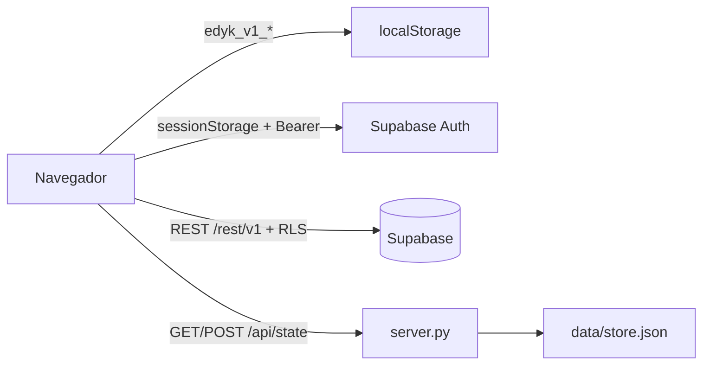

<div align="center">


# EDY-K Barbershop

**Agendamento online, loja de produtos e painel administrativo em HTML, CSS e JavaScript puro — sem build, sem npm e sem etapa de compilação.**

<p>
  
  
  
  
  
  
</p>

</div>


## Sumário

- [Visão geral](#visão-geral)
- [Stack](#stack)
- [Funcionalidades](#funcionalidades)
- [Guia rápido](#guia-rápido)
- [Contas de demonstração](#contas-de-demonstração)
- [Perfis de acesso](#perfis-de-acesso)
- [Arquitetura de dados](#arquitetura-de-dados)
- [Integração com Supabase](#integração-com-supabase)
- [Testes](#testes)
- [API local (Python)](#api-local-python)
- [Deploy](#deploy)
- [Estrutura do projeto](#estrutura-do-projeto)
- [Segurança](#segurança)
- [Solução de problemas](#solução-de-problemas)
- [Changelog](#changelog)
- [Roadmap](#roadmap)
- [Contribuindo](#contribuindo)
- [Contato](#contato)
- [Licença](#licença)

## Visão geral

Este repositório contém a versão definitiva da EDY-K Barbershop, convertida de **React + TypeScript + Vite** para **HTML, CSS, JavaScript clássico e Python**.

O resultado é uma SPA leve que pode ser executada de três formas:

1. Abrindo `index.html` diretamente (`file://`);
2. Rodando `python server.py` em localhost, com API opcional de persistência;
3. Fazendo deploy estático no Vercel.

Não há `package.json`, `node_modules`, transpilação ou build. Usuários e produtos podem ser sincronizados com **Supabase** via REST; os demais dados seguem no `localStorage` do navegador.

## Stack

| Camada | Tecnologia | Uso |
| --- | --- | --- |
| Interface | HTML5 + CSS3 | Layout responsivo, tema escuro/dourado, componentes e animações |
| Lógica | JavaScript clássico (`app-v2.js`) | Rotas por hash, estado, agendamentos, loja, fidelidade e admin |
| Configuração | `config.js` | URL e chave pública do Supabase |
| Banco remoto | Supabase REST / PostgREST | Tabelas `users` e `products` |
| Persistência local | `localStorage` (`edyk_v1_*`) | Agendamentos, pedidos, pontos, carrinho e configurações |
| Servidor local | Python 3 (`http.server`) | Arquivos estáticos + API `GET/POST /api/state` |
| Deploy | Vercel (`vercel.json`) | Hospedagem estática sem build |
| PWA | `manifest.webmanifest` + ícones | Instalação e ícones adaptativos |

## Funcionalidades

### Área do cliente

- Página inicial com serviços, elenco, avaliações, loja e disponibilidade.
- Agendamento em 4 etapas: serviço → profissional → data/hora → dados e pagamento.
- Remarcação, cancelamento, histórico e avaliação de atendimentos.
- Loja com filtros por categoria, carrinho e checkout.
- Pagamento via Pix ou cartão, com retirada/entrega, cupons e frete.
- Baixa automática de estoque após compra.
- Meus Pedidos e Meus Horários.
- Programa de fidelidade: pontos, resgate de recompensas e extrato.
- Login e cadastro via Supabase Auth quando configurado; acessos rápidos apenas no modo demo offline.

### Painel administrativo

- Dashboard com indicadores.
- Gestão da agenda, status de agendamentos e marcação de pagamento recebido.
- Gestão de pedidos: status de entrega e pagamento pago/pendente.
- Consultar, criar, editar e excluir serviços, produtos, barbeiros e recompensas. Itens criados pelo administrador ficam locais até o proprietário sincronizar.
- CRUD de usuários e abas **Supabase** e **Configurações** exclusivas do proprietário.
- Sincronização remota de produtos apenas com o proprietário autenticado; o administrador parcial trabalha no conteúdo local.
- Avaliações e comentários: responder, editar, ocultar/aprovar e excluir avaliações; editar e excluir respostas. As respostas aparecem na página inicial.
- Configuração de fidelidade (edição pela equipe) e CMS geral da loja (somente proprietário).

### Infraestrutura

- Tema EDY-K escuro/dourado com responsividade para desktop, tablet e mobile.
- PWA com manifest e ícones 192/512/maskable.
- Compatível com `file://`, `localhost` e domínios estáticos.
- Sem dependências de terceiros no front-end.

## Guia rápido

### Pré-requisitos

- Navegador moderno com suporte a `fetch` e `localStorage`.
- **Opcional:** Python 3.8+ para o servidor local.
- **Opcional:** Node.js 18+ para o script de teste do Supabase.

### Opção 1 — abrir direto no navegador

Abra `index.html` com duplo clique. Nenhum servidor é necessário.

### Opção 2 — servidor Python (recomendado em desenvolvimento)

```bash
python server.py          # http://localhost:8000
python server.py 3000     # porta personalizada
```

Ativa a API local de persistência em `data/store.json`. Sem ela, o app usa apenas `localStorage`.

### Opção 3 — Vercel

Importe o repositório no Vercel e use:

| Configuração | Valor |
| --- | --- |
| Framework Preset | `Other` |
| Build Command | vazio |
| Install Command | vazio |
| Output Directory | `.` |

Esses valores já estão em `vercel.json`. Não é preciso `npm install` nem variáveis de ambiente. A API Python não é implantada e o app detecta isso automaticamente.

## Contas de demonstração

| Perfil | E-mail | Senha sugerida |
| --- | --- | --- |
| Proprietário | `trabalhojonatha@gmail.com` | `owner123` |
| Administrador parcial | `admin@edyk.com` | `admin123` |
| Cliente | `cliente@edyk.com` | `123456` |

- **Sem Supabase configurado:** são contas locais, com botões de acesso rápido na tela de login.
- **Com Supabase configurado:** crie esses e-mails em **Authentication → Users**, use as senhas escolhidas e defina os papéis em `raw_app_meta_data` conforme o passo 2 da integração. Os botões de acesso rápido desaparecem; o login passa a ser feito pelo Supabase Auth.

> Troque as senhas sugeridas antes de usar em produção — elas aparecem nesta documentação.

## Perfis de acesso

| Perfil | Painel | Criar itens | Usuários / Supabase / Configurações | Banco de dados (Supabase) |
| --- | --- | --- | --- | --- |
| **Proprietário** (`owner`) | Sim | Sim | Sim | Acesso total (`users` e `products`) |
| **Administrador** (`admin`) | Sim | Sim (somente locais) | Não | **Nenhum acesso** — nenhuma chamada REST de banco |
| **Cliente** (`client`) | Não | Não | Não | Só o próprio perfil via RLS |

O nível vem sempre do JWT assinado pelo Supabase (`app_metadata.role`). O app decodifica essa claim **apenas para mostrar/esconder a interface**; quem autoriza de verdade é o RLS. Mexer em `localStorage`, em `user_metadata` ou na tabela `users` não concede privilégios.

O administrador parcial pode consultar, editar e excluir conteúdo do painel (agenda, pedidos, avaliações, serviços, produtos, barbeiros e recompensas), mas:

- não vê as abas **Usuários**, **Supabase** nem **Configurações**;
- pode usar o botão **Novo** para criar itens, mas eles ficam apenas no navegador até o proprietário sincronizar;
- não dispara `sbRequest()` nem carrega/perfila usuários e produtos remotamente;
- não cria nem edita usuários do banco.

## Arquitetura de dados



| Dado | Onde fica |
| --- | --- |
| Contas e senhas | Supabase Auth (`auth.users`), quando configurado; `localStorage` apenas no modo demo offline |
| Perfis e produtos | Supabase, protegidos por RLS; `localStorage` como fallback |
| Agendamentos, pedidos, pontos, recompensas, carrinho e configurações | `localStorage` |
| Estado compartilhado em localhost | `data/store.json` via API Python |
| Sessão (`edyk_auth_session`) e perfil atual | `sessionStorage` do navegador; nunca enviados para a API compartilhada |

## Integração com Supabase

A integração usa **Supabase Auth + REST/PostgREST direto no navegador**, sem SDK e sem npm. A chave publicável/anon é própria para o cliente; a `service_role` nunca deve aparecer no front-end.

### 1. Prepare o banco

1. Crie um projeto em [supabase.com](https://supabase.com).
2. Aba **SQL Editor → New query**.
3. Execute todo o conteúdo de [`supabase.sql`](supabase.sql).

> O script **recria `public.users`**. As tabelas atuais estão vazias, mas exporte dados se houver informações importantes.

O SQL cria perfis ligados a `auth.users`, remove a coluna de senha, habilita RLS, aplica `GRANT`s mínimos e cria os helpers `public.current_role()`, `public.is_owner()`, `public.is_admin()` e `public.my_role()`. Todos leem o papel do **JWT assinado** — nunca `localStorage`, tabela `users` ou `user_metadata` (campo que qualquer visitante pode definir no cadastro). Por compatibilidade, `is_admin()` é hoje sinônimo de `is_owner()`: o administrador parcial retorna `false`.

### 2. Crie os usuários no Supabase Auth

Em **Authentication → Users → Add user**, crie:

- `trabalhojonatha@gmail.com` com a senha do proprietário;
- `admin@edyk.com` com a senha do administrador parcial;
- `cliente@edyk.com` com a senha de cliente (opcional, para testes).

Depois, ainda no SQL Editor, defina os papéis (o SQL de exemplo também está no final de `supabase.sql`):

```sql
-- Proprietário: acesso total, inclusive banco
update auth.users
set raw_app_meta_data = coalesce(raw_app_meta_data, '{}'::jsonb) || '{"role":"owner"}'::jsonb,
    raw_user_meta_data = coalesce(raw_user_meta_data, '{}'::jsonb) - 'role'
where email = '';

-- Administrador parcial: painel local, sem acesso ao banco
update auth.users
set raw_app_meta_data = coalesce(raw_app_meta_data, '{}'::jsonb) || '{"role":"admin"}'::jsonb,
    raw_user_meta_data = coalesce(raw_user_meta_data, '{}'::jsonb) - 'role'
where email = '';
```

> **Importante:** use `raw_app_meta_data`, nunca `raw_user_meta_data`. O `user_metadata` é enviado pelo próprio cliente no cadastro; usá-lo como fonte de autorização permitiria que qualquer pessoa se registrasse com `{"role":"admin"}` e obtivesse acesso ao painel. Para revogar um papel: `update auth.users set raw_app_meta_data = raw_app_meta_data - 'role' where email = '';`

Faça **logout/login** no app para o JWT receber a nova claim. No primeiro login, o proprietário tem o perfil gravado como `owner` e o cliente como `client`; o administrador parcial **não** cria perfil remoto, justamente porque não acessa o banco. Se a conta `` havia sido promovida antigamente via `user_metadata`, remova essa chave (os SQL acima já fazem isso).

### 3. Configure as credenciais

Edite `config.js`:

```js
window.EDYK_SUPABASE = {
  url: 'https://SEU-PROJETO.supabase.co',
  anonKey: 'SUA_PUBLISHABLE_OU_ANON_KEY'
};
```

Também é possível configurar pelo app, sem redeploy:

**PAINEL ADMIN (proprietário) → Supabase → preencher URL/chave → SALVAR E CONECTAR**

Prioridade de configuração:

1. `localStorage.edyk_supabase_config` (painel admin);
2. `window.EDYK_SUPABASE` (`config.js`).

Salvar o painel com campos vazios limpa a configuração anterior e volta a usar o arquivo.

### 4. O que o RLS permite

| Operação | Visitante (anon) | Cliente | Admin parcial | Proprietário |
| --- | --- | --- | --- | --- |
| Ler produtos ativos | ✅ | ✅ | ❌ | ✅ |
| Ler produtos inativos | ❌ | ❌ | ❌ | ✅ |
| Criar/editar/excluir produtos no banco | ❌ | ❌ | ❌ | ✅ |
| Ler próprio perfil | ❌ | ✅ | ❌ | ✅ |
| Ler todos os perfis | ❌ | ❌ | ❌ | ✅ |
| Criar próprio perfil | ❌ | ✅ (sempre `client`) | ❌ | ✅ (como `owner`) |
| `rpc/is_owner` / `rpc/is_admin` | `false` | `false` | `false` | `true` |

### 5. Sincronização automática

Com a conexão ativa, o app:

- autentica login/cadastro pelo Supabase Auth;
- cria o perfil remoto apenas para proprietário e clientes;
- carrega produtos e perfis autorizados, mesclando pelo `id` — exceto no perfil administrador parcial, que não faz chamadas ao banco;
- grava, edita e exclui produtos no CRUD somente com sessão do proprietário;
- atualiza o estoque remoto após cada pedido somente quando o proprietário está conectado;
- mantém agendamentos, pedidos, pontos e carrinho no `localStorage`.

Contas de acesso são gerenciadas no Supabase Auth. O painel não cria nem apaga usuários do Auth; alterações locais de perfil são apenas cosméticas e não alteram permissões.

## Testes

### Pelo painel (somente proprietário)

Entre como **proprietário** (``) e vá em **PAINEL ADMIN → Supabase → TESTAR INSERÇÃO/EXCLUSÃO**. A aba não aparece para o administrador parcial.

O teste valida:

1. permissão de proprietário via `rpc/is_owner`;
2. inserção de produto temporário;
3. leitura do próprio perfil;
4. leitura pública do produto ativo;
5. exclusão do produto temporário.

Resultado esperado: **PASSOU (5/5)**.

### Pelo terminal

O script valida o proprietário (acesso total), o administrador parcial (acesso negado) e o visitante anônimo.

```bash
# macOS/Linux
SUPABASE_OWNER_EMAIL=---- \
SUPABASE_OWNER_PASSWORD=SUA_SENHA \
SUPABASE_ADMIN_EMAIL=---- \
SUPABASE_ADMIN_PASSWORD=SUA_SENHA \
node test-supabase.mjs
```

```powershell
# Windows PowerShell
$env:SUPABASE_OWNER_EMAIL = "----"
$env:SUPABASE_OWNER_PASSWORD = "SUA_SENHA"
$env:SUPABASE_ADMIN_EMAIL = "----"
$env:SUPABASE_ADMIN_PASSWORD = "SUA_SENHA"
node test-supabase.mjs
```

`SUPABASE_URL` e `SUPABASE_ANON_KEY` são opcionais: se não existirem, o script lê `config.js`.

Resultado esperado (resumo):

```text
OK   Login do proprietário
OK   Proprietário reconhecido pelo RLS
OK   Compatibilidade is_admin() = proprietário
OK   Perfil atual via RPC
OK   Proprietário insere produto
OK   Proprietário consulta produto
OK   Proprietário lê próprio perfil
OK   Anônimo lê produto ativo
OK   Anônimo NÃO grava produto
OK   Anônimo NÃO lê usuários
OK   Login do administrador parcial
OK   Admin parcial NÃO é proprietário no RLS
OK   Admin parcial NÃO lê produtos
OK   Admin parcial NÃO grava produto
OK   Admin parcial NÃO altera produto
OK   Admin parcial NÃO lê usuários
OK   Excluir produtos de teste

Resultado: SUCESSO (17/17 etapas)
```

### Validação das permissões do painel

| Ação no painel | Proprietário | Administrador parcial |
| --- | --- | --- |
| Ver abas Usuários / Supabase / Configurações | ✅ | ❌ (ocultas) |
| Criar serviços, produtos, barbeiros e recompensas | ✅ | ✅ (apenas no navegador) |
| Consultar, editar e excluir conteúdo local | ✅ | ✅ |
| Editar configurações da loja e restaurar demo | ✅ | ❌ |
| Testar/publicar no Supabase | ✅ | ❌ (nenhuma chamada REST) |
| Responder avaliações e gerenciar pedidos/agenda | ✅ | ✅ |
| Alterar papel pelo `localStorage` | ❌ | ❌ (JWT + RLS mandam) |

Teste negativo adicional: deslogado, tentativas de alterar pedido, responder avaliação ou abrir formulário de CRUD continuam bloqueadas pelos guards de acesso.

## API local (Python)

Disponível somente em `localhost` quando `server.py` está rodando.

| Método | Rota | Descrição |
| --- | --- | --- |
| `GET` | `/health` ou `/api/health` | Health check; responde `{"status":"ok"}` |
| `GET` | `/api/state` | Retorna o estado salvo em `data/store.json` |
| `POST` | `/api/state` | Salva o estado recebido em `data/store.json` |

A sessão `currentUser` é deliberadamente excluída do estado compartilhado.

## Deploy

O deploy é inteiramente estático. O `vercel.json` já define `framework: null`, `buildCommand: null`, `installCommand: null` e `outputDirectory: "."`.

No Vercel:

- `server.py` não é executado;
- a API local `/api/state` não existe e é ignorada pelo app;
- `localStorage` continua funcionando normalmente;
- com Supabase configurado, usuários e produtos são compartilhados entre dispositivos e origens.

## Estrutura do projeto

```text
.
├── index.html              # SPA, emblema SVG e carregamento dos scripts
├── styles.css              # Tema EDY-K, layout e responsividade
├── app-v2.js               # Estado, rotas, regras de negócio, Auth e integração Supabase
├── config.js               # URL e chave pública do Supabase
├── server.py               # Servidor estático + API JSON local
├── supabase.sql            # Perfis, GRANTs mínimos, RLS e helpers owner/admin
├── test-supabase.mjs       # Teste de Auth, RLS e acesso negado ao admin parcial
├── vercel.json             # Configuração de deploy estático
├── manifest.webmanifest    # PWA
├── metadata.json           # Metadados do aplicativo
├── assets/
│   ├── icon.svg
│   ├── icons/              # Ícones PWA 192/512/maskable
│   └── images/             # Hero, elenco, barbeiros e produtos
├── public/                 # Legado estático mantido por compatibilidade
└── data/                   # store.json gerado pelo servidor Python (ignorado no Git)
```

## Segurança

- A chave `anon`/`publishable` pode ficar no front-end **somente com RLS configurado**.
- **Nunca** coloque a `service_role` em `config.js`, no painel ou em qualquer arquivo cliente.
- Login/cadastro usam Supabase Auth; a tabela `public.users` não armazena senha.
- RLS usa `auth.uid()`, `public.current_role()`, `public.is_owner()` e `public.is_admin()` — todos baseados em **`app_metadata` do JWT assinado**. Mudar o `role` no `localStorage`, na tabela ou no `user_metadata` não concede privilégios.
- Visitantes e clientes só leem produtos ativos; o administrador parcial não lê tabelas remotas; escrita remota é exclusiva do proprietário.
- O front-end decodifica a claim `app_metadata.role` somente para esconder/mostrar controles. Não há confiança nessa decodificação para autorização: o RLS bloqueia qualquer chamada direta.
- O token de sessão fica em `sessionStorage` (`edyk_auth_session`) e **não** é enviado para a API Python compartilhada; ele expira com a aba do navegador.
- Em dispositivos compartilhados, use o botão do nome no topo (**Sair da conta**) ao terminar; o botão **Sair do painel** da área admin apenas volta à home.
- `server.py` escuta apenas em `127.0.0.1` por padrão. Para expor na rede (`--host 0.0.0.0`), defina `EDYK_API_TOKEN` e informe o mesmo valor em `config.js` (`localApiToken`) — o cabeçalho `X-EDYK-Token` passa a ser exigido em `/api/state`. O corpo da requisição é limitado a 2 MB.
- Não exponha `data/store.json` em um servidor público: ele contém o estado local da aplicação.
- Para produção, mantenha confirmação de e-mail ativada no Supabase Auth e considere mover agendamentos/pedidos para tabelas com RLS próprio.

### Auditoria SAST (2026-11-21)

Achados corrigidos nesta revisão:

| Achado | Severidade | Correção |
| --- | --- | --- |
| `is_admin()` lia `user_metadata.role`, permitindo escalonamento via cadastro público com `{"role":"admin"}` | Crítica | Passou a ler somente `app_metadata.role`; promoção agora usa `raw_app_meta_data` |
| Não havia separação entre proprietário e administrador parcial | Alta | Perfis `owner` e `admin`; `admin` não acessa `users`/`products` no RLS e não dispara REST no app |
| `authProfile()` replicava `user_metadata.role` no perfil local | Média | Perfis criados no login sempre começam como `client` (ou `owner`, pela claim) |
| `/api/state` aceitava escrita sem token e o servidor escutava em `0.0.0.0` | Média | Bind padrão em loopback, token opcional `EDYK_API_TOKEN`, limite de 2 MB e validação do payload |
| IDs e datas interpolados em atributos `data-*` sem escaping | Baixa | Aplicação de `esc()` em todos os atributos derivados de dados |
| Expressão morta no `<option>` de “Marcar pago” da agenda | Baixa | Removida |

Validação recomendada após aplicar o SQL: faça logout/login nas duas contas e rode `node test-supabase.mjs` com as duas senhas. Como teste manual de regressão, cadastre um usuário com `data: {"role":"admin"}` pelo próprio Auth e confirme que `POST /rest/v1/rpc/is_admin` retorna `false` (claim forjada em `user_metadata` não serve). Conectado como administrador parcial, confirme que nenhuma requisição aparece para `/rest/v1/*` no painel do navegador.

## Solução de problemas

| Sintoma | Causa provável | Solução |
| --- | --- | --- |
| `401` com `No API key found` | Chave não preenchida | Preencha `anonKey` em `config.js` ou no painel |
| `PGRST205` | Tabelas não criadas ou cache antigo | Execute `supabase.sql`; se persistir, rode `notify pgrst, 'reload schema';` |
| `42501 permission denied` | RLS/GRANT não aplicado ou papel errado | Rode novamente `supabase.sql` e entre com a conta correta |
| `401` no login com Supabase | Usuário não existe no Auth ou senha errada | Crie o usuário em **Authentication → Users** e tente novamente |
| “Acesso exclusivo do proprietário” | Conta `----` tentou usar banco/configurações | Entre como `----` para essas áreas |
| Painel Admin não aparece | `raw_app_meta_data.role` não é `owner`/`admin` | Rode o SQL de promoção e faça logout/login |
| Produtos não aparecem no painel do administrador parcial | Perfil sem acesso ao banco (comportamento esperado) | Use o proprietário para sincronizar; o admin vê apenas dados locais |
| `new row violates row-level security policy` ao cadastrar | Perfil com `role` diferente do permitido | Cadastre pelo app; nunca envie `role: admin`/`owner` no signup |
| `404` no Vercel para `/api/state` | API Python não existe no deploy | Normal; o app usa `localStorage`/Supabase |
| Status “Configuração incompleta” | URL ou chave vazia | Confira os campos em **Admin → Supabase** |
| Login não persiste após reload | Sessão expirada/configuração alterada | Faça login novamente; o token é renovado automaticamente quando possível |

## Changelog

### 2026-11-22

- **Criação liberada para a equipe:** o administrador agora vê o botão **Novo** e cria serviços, produtos, barbeiros e recompensas localmente. Usuários, Supabase, Configurações e o banco remoto continuam exclusivos do proprietário.
- **Auditoria matemática:** frete calculado sobre o valor após desconto, cupons filtrados por tipo (serviço/produto/ambos), receita da loja conta só pedidos pagos, parcelas limitadas a 1–6, estoque/quantidades inteiros, promoção só quando menor que o preço normal, ajuste de quantidade ao estoque no fechamento do pedido, pontos calculados sobre o valor pago (com ajuste ao remarcar) e resumo do checkout recalculado ao vivo.
- Cache-buster do script atualizado para `app-v2.js?v=20261122-admin-cria`.

### 2026-11-21

- **Distinção de usuários:** `-----` é proprietário (`owner`, acesso total) e `----` é administrador parcial (`admin`, sem acesso ao banco).
- Administrador parcial não vê abas de Usuários/Supabase/Configurações, não cria itens e não faz chamadas `/rest/v1/*`; alterações ficam locais.
- RLS reforçado com `current_role()`, `is_owner()` e `is_admin()` (sinônimo de `is_owner()`); `admin` é negado até na leitura de `products`/`users`.
- Testes reescritos para validar proprietário, administrador negado e visitante anônimo (17 etapas).
- **Correção crítica de segurança (SAST):** as funções de papel agora leem apenas `app_metadata.role`, fechando o escalonamento de privilégio via `user_metadata` no cadastro.
- Perfis criados no primeiro login passam a ser `client` ou `owner` conforme a claim do JWT.
- `server.py` passa a escutar em `127.0.0.1`, aceita `EDYK_API_TOKEN`/`--host` e limita o corpo de `/api/state` a 2 MB.
- Escaping aplicado a atributos `data-*` derivados de dados no front-end.

### 2026-11-20

- **Segurança reforçada:** login/cadastro passam a usar Supabase Auth quando configurado.
- Tabela `public.users` recriada sem senha, ligada a `auth.users`, com perfis criados no primeiro login.
- RLS por `auth.uid()` e helper `is_admin()` baseado no JWT; anon lê só produtos ativos e não acessa usuários.
- CRUD remoto de produtos restrito a admins; usuários passam a ser gerenciados no Supabase Auth.
- Testes reescritos para validar Auth, RLS, negação de acesso anônimo e limpeza de resíduos.
- Conversão completa de React/TypeScript/Vite para HTML/CSS/JavaScript/Python.
- Remoção de `ERESOLVE`, `/src/main.tsx`, caminhos absolutos e dependência de build.
- Correção de imagem `.jpeg`/`.jpg`, ícones PWA e responsividade em 1200/900/375 px.
- Correção de termos e navegação ("terapia"/"barboterapia").
- Integração Supabase para `users` e `products` via REST puro.
- Novo SQL com tabelas, `GRANT`s, RLS e reload de schema.
- Abas Admin → Usuários e Admin → Supabase.
- Testes automatizados de insert/consulta/delete no terminal e no painel.
- API Python com `/health` e `log_message` corrigido para erros 404.
- Sessão do navegador isolada da API compartilhada.
- README reestruturado no padrão de documentação de projetos públicos.

## Roadmap

- Adicionar recuperação de senha e confirmação de e-mail ao fluxo do app.
- Levar agendamentos e pedidos também para o banco remoto com RLS por usuário.
- Substituir a API Python por uma camada serverless para operações administrativas sensíveis.
- Adicionar testes automatizados de interface com Playwright.

## Contribuindo

1. Faça um fork do repositório.
2. Crie uma branch: `git checkout -b feature/minha-melhoria`.
3. Faça alterações mantendo o projeto sem build e sem npm.
4. Valide com `node --check app-v2.js` e `python -m py_compile server.py`.
5. Abra um pull request descrevendo o impacto e os testes realizados.

## Contato

- **Endereço:** R. Juiz de Fora, 279 — Vila Ema, São Paulo - SP
- **Telefone:** (11) 98254-1469
- **WhatsApp:** [Falar com a EDY-K](https://wa.me/message/X5EVZRC2S7CYE1)
- **Instagram:** [@barbearia_edyk](https://instagram.com/barbearia_edyk)

## Licença

Projeto mantido pela EDY-K Barbershop. Para reutilização ou distribuição, entre em contato com o proprietário da marca.
